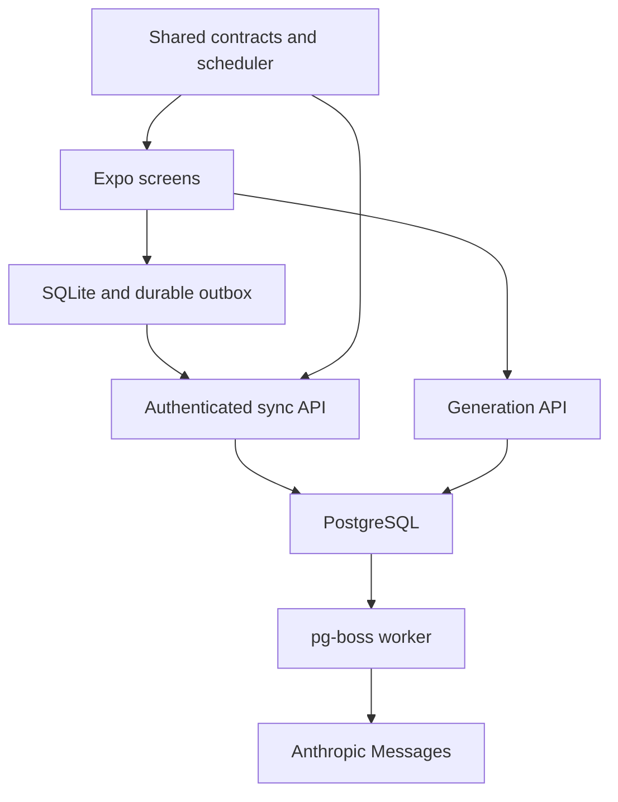

# Recollect architecture and rollout

## Runtime design

Expo owns the product UI and local persistence. A TypeScript Fastify API owns verified identity, canonical content and schedules. PostgreSQL stores application state and durable job intent; pg-boss transports work to a separate worker. Both device and server import the same scheduler and Zod wire contracts.

The original Swift/Python source stays available for recovery. The new normal runtime uses the additive `recollect` database schema and does not depend on those implementations.

## Identity

The device sends a server nonce's SHA256 hash to Apple. The API verifies Apple's signature, issuer, audience, expiry and nonce, then consumes the challenge once. A verified Apple subject reuses the original internal UUID; email or cached device defaults cannot link identities. Inactive accounts are denied.

Access tokens have a distinct issuer/audience and a live session check. Legacy JWTs are not accepted. Opaque refresh secrets are hashed and rotated. Session-family locking/revocation prevents concurrent refreshes from escaping old-token reuse invalidation.

Credentials live in SecureStore. The installation device ID and its review sequence live together in SQLite, so an uninstall cannot retain a Keychain device ID while resetting its counter. Account switches invalidate in-flight request state before old content can be sent under a new token. Every local table, server command and widget publication is owner-scoped.

## Scheduler

`sm2-v1` receives explicit time inputs and has no randomness. Ratings are `again`, `hard`, `good`, `easy`; intervals are seconds. These are versioned product rules with regression fixtures:

| State/rating   | Behavior                                               |
| -------------- | ------------------------------------------------------ |
| Learning Again | One minute; reset learning step                        |
| Learning Good  | Ten minutes, then graduate at one day on the next Good |
| Learning Hard  | Repeat the current learning step                       |
| Learning Easy  | Graduate at four days                                  |
| Review Hard    | Interval × 1.2; ease − 0.15                            |
| Review Good    | Interval × current ease                                |
| Review Easy    | Interval × ease × 1.3, at least four days; ease + 0.15 |
| Review Again   | Record lapse; ease − 0.2; one-minute relearning        |

New reviews bound ease to 1.3–3.0 and round intervals to whole seconds, with a maximum of 3,650 days. Imported checkpoints preserve finite fractional intervals, existing due dates, and legacy ease above 3 exactly. On the next rating, the scheduler first bounds the starting ease and then applies the new rules. This avoids rejecting ordinary values produced by the original Swift scheduler or silently changing when an imported card is due. Negative, nonfinite, unsafe numeric values and invalid dates still require recovery. Rating-derived recall is labeled self-rated; it is not an objective correctness measurement. Earlier imported reviews are archival.

A review transaction inserts a unique immutable event, replays post-checkpoint history in effective-time/device/sequence/ID order, updates the current schedule, and publishes changes atomically. Future clock skew above five minutes is rejected. Reviews older than the recoverable checkpoint stay available for explicit recovery, rather than being replayed against unavailable history.

## Offline consistency

Local edits, review rows, visible schedules and outbox entries commit together in SQLite. Sending records an attempt before network I/O. Retried commands retain their UUID and exact payload. Only an acknowledged local predecessor can advance an unsent dependent edit's base version; pulling another device's changes must not turn a stale edit into a silent overwrite.

The API separately deduplicates operation IDs and review event IDs within each owner, checking payload hashes. Changed content under an existing identity is rejected. Stale duplicate receipts cannot replace newer canonical versions. Confirmed remote review IDs prevent a still-pending local event from being scheduled twice after a lost acknowledgement.

A per-owner row lock serializes write revisions through commit. The change feed contains immutable payloads. Pull pins a high watermark and pages whole revision groups; the local page and cursor commit together. A late server commit cannot fall behind an already advanced cursor, and a deletion's child tombstones are not split from the parent revision.

Initial sync starts at revision zero. Change retention is currently unbounded: implement snapshot/rebase recovery before pruning it. Stale writes surface a conflict with both canonical and local variants. Resolving in favor of server state archives the discarded local work. A chosen retry uses a new operation identity. Deleted records are tombstones. Moving reviewed cards between decks requires an explicit history policy; copying is supported instead.

## Durable AI work

The API reserves the account's daily requested-card budget and commits a job before acknowledging. Job rows are the dispatch outbox. A crash between queue send and dispatch acknowledgement may duplicate transport, while job leases and fencing prevent duplicate result publication.

Every attempt has a deadline/fence. Completion must still match the active unexpired attempt; cancellation revokes it. Transient errors use persisted backoff with at most three attempts. Anthropic structured output is validated; missing credentials, malformed output and failed calls stay failures. Actual usage is retained when the provider returns it.

Successful candidates receive stable UUIDs. Acceptance creates cards with those IDs and saves an idempotent receipt. The quota is conservative: failed/canceled requests do not automatically refund potential provider cost. It is not billing or a claim of exactly-once external charging.

## Recovery

The server importer reads inspected legacy public tables, preserves internal UUIDs, converts day-based intervals, archives history and saves a manifest fingerprint. Repeating an unchanged import is safe. Changed input, identity collisions or invalid schedule values require reconciliation.

The device reader makes a WAL-consistent protected backup, opens an isolated working copy using exact archived Swift model identities, and exports logical records. The UI confirms ownership and persists an idempotent import request. The API requires recent authentication, preserves source evidence and never overwrites an existing canonical identity. Minute-based Swift intervals are distinct from the old server's day-based fields.

The original device store lacks owner columns and some AI-generated local IDs differ from server IDs. Account hints and equal question text cannot prove ownership or identity. Unsupported schemas, ambiguous accounts, invalid values and collisions remain explicit recovery cases. Keep source backups and manifests through the supported upgrade window. See `native-migration.md` for the precise reader limits and widget behavior.

## Release sequence

1. **Inspect deployed reality.** Identify oldest supported builds, signed entitlements, current schema and used login methods. Take a backup and prove restore. The checked-in SQL dump does not establish production state. If email/password accounts still matter, implement a compatible recovery path before moving them; do not link to Apple by email.
2. **Stage independently.** Use a new API/worker service and reviewed database copy. Generate a signing secret, run additive migration and explicit queue setup, then import a stable snapshot. Verify IDs/counts/relationships and retain manifests. Configure a staged HTTPS API and EAS project.
3. **Prove the installed upgrade.** Install a real old signed build; create manual/AI cards, offline reviews and failed/pending queue entries; upgrade directly to Expo under the same app identity. Cover skipped transitional releases, ownership, backups, checkpoints, account switches, force-quits, Apple reauthentication and installed widgets. Fixture tests cannot substitute for this check.
4. **Gate writers and cut over.** Release the recovery-capable client, enforce the reviewed minimum version, stop incompatible legacy writes, take the final backup, import a stable snapshot, then switch routing. New `/api/*` endpoints deliberately return an upgrade response. Do not operate independent Python and TypeScript schedulers on one account.
5. **Operate and retire deliberately.** Monitor auth rejection, session reuse, sync conflicts/rejections, pending outboxes, import failures/counts, queue age, provider errors and restore readiness. Retain a compatible previous TypeScript build and all new writes. Snapshot rollback can erase newly accepted reviews; replay them or fix forward. OTA rollback does not undo SQLite migrations.

Retire Python and the native reader only after the supported-client/recovery windows close. Verified billing, account deletion across legacy archives, notifications, Android auth and complete superset semantics need separate product behavior before being presented as available.

## Verification

Tests cover scheduling fixtures, runtime contracts, actual SQLite persistence and outboxes, account isolation, conflict retention, authentication and session races, PostgreSQL review/import/job transactions, structured provider output, and native recovery fixtures. Cross-stack tests exercise SQLite through the authenticated API with restarts and a deliberately lost acknowledgement.

`npm run test:embedded` supplies a fresh PostgreSQL WASM process. CI runs database tests against PostgreSQL 16 and native source checks on macOS. After the one-time [CI/CD setup](ci-cd.md), pushes to `main` deploy the isolated staging API/worker and release the app to the TestFlight channel through OTA or a new native build. Public App Store promotion and legacy production cutover remain separate. Feature work stays branch-based and checked by CI.
