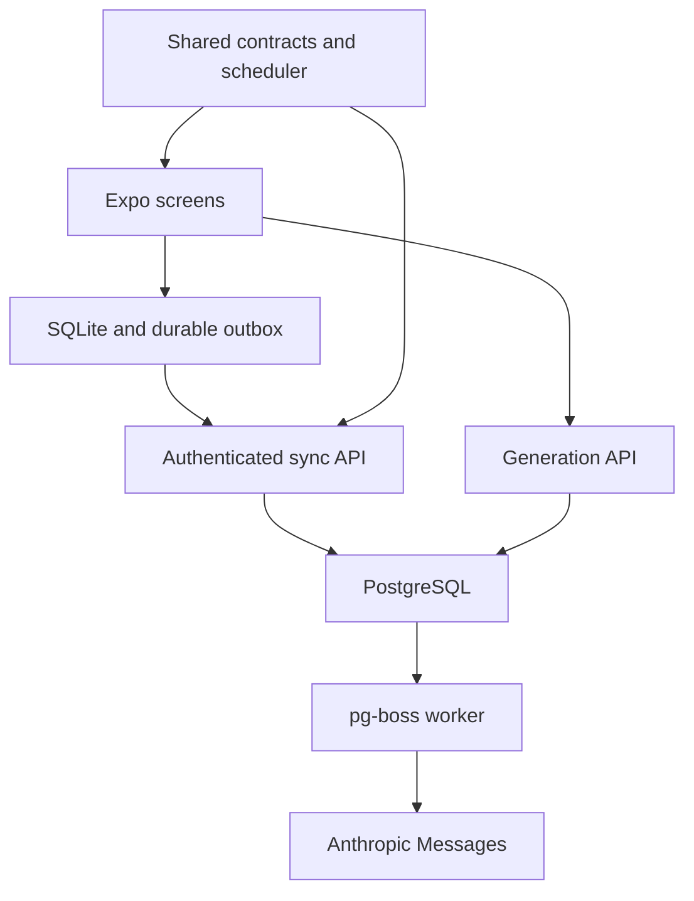

# Recollect architecture and rollout

## Runtime design

Expo owns the product UI and local persistence. A TypeScript Fastify API owns verified identity, canonical content and schedules. PostgreSQL stores application state and durable job intent; pg-boss transports work to a separate worker. Both device and server import the same scheduler and Zod wire contracts.

The original Swift/Python source stays available for recovery. The new normal runtime uses the additive `recollect` database schema and does not depend on those implementations.

## Identity

The device sends a server nonce's SHA256 hash to Apple. The API verifies Apple's signature, issuer, audience, expiry and nonce, then consumes the challenge once. A verified Apple subject reuses the original internal UUID; email or cached device defaults cannot link identities. Inactive accounts are denied.

Access tokens have a distinct issuer/audience and a live session check. Legacy JWTs are not accepted. Opaque refresh secrets are hashed and rotated. Session-family locking/revocation prevents concurrent refreshes from escaping old-token reuse invalidation.

Credentials live in SecureStore. The installation device ID and its review sequence live together in SQLite, so an uninstall cannot retain a Keychain device ID while resetting its counter. Account switches invalidate in-flight request state before old content can be sent under a new token. Every local table, server command and widget publication is owner-scoped.

## Scheduler

`sm2-v2` receives explicit time inputs and has no randomness. Ratings are `again`, `hard`, `good`, `easy`; intervals are seconds. Daily review and practice use the same rules, with no automatic repeats in the session:

| State/rating      | Behavior                                                                      |
| ----------------- | ----------------------------------------------------------------------------- |
| Again / Not sure  | Three days; reset successful repetitions and enter relearning                 |
| Good / I remember | At least seven days; established review interval × ease                       |
| Hard              | At least three days; established review interval × 1.2; ease − 0.15           |
| Easy              | At least fourteen days; established review interval × ease × 1.3; ease + 0.15 |

Each immutable event carries its algorithm version. Historical `sm2-v1` events still use their original one-/ten-minute learning steps, so replay, duplicate transport, and old offline outboxes retain their meaning. New events use v2. A stored checkpoint's due date is preserved until its next review. The app advertises v2 support in `X-Recollect-Scheduler`; older clients continue syncing until their account contains v2 review data, then receive an actionable 426 update message before writing or decoding unsupported data.

New reviews bound ease to 1.3–3.0 and round intervals to whole seconds, with a maximum of 3,650 days. Imported checkpoints preserve finite fractional intervals, existing due dates, and legacy ease above 3 exactly. On the next rating, the scheduler first bounds the starting ease and then applies the new rules. This avoids rejecting ordinary values produced by the original Swift scheduler or silently changing when an imported card is due. Negative, nonfinite, unsafe numeric values and invalid dates still require recovery. Rating-derived recall is labeled self-rated; it is not an objective correctness measurement. Earlier imported reviews are archival.

A review transaction inserts a unique immutable event, replays post-checkpoint history in effective-time/device/sequence/ID order, updates the current schedule, and publishes changes atomically. Future clock skew above five minutes is rejected. Reviews older than the recoverable checkpoint stay available for explicit recovery, rather than being replayed against unavailable history.

### Categories and review rules

The category implementation builds on the dormant token-economy foundation.
Its first native rollout is through `feature/categories-and-generation-tokens`;
production deployment and device verification must be recorded separately.
Existing decks start in **Uncategorized**;
each owned deck can belong to one private category. Category removal unassigns
decks and preserves every card, due date, and review event. Shared and marketplace
copies do not inherit a publisher's private categories or review rules.

Global review rules apply to all decks. Categories can inherit the global cadence
or override it, and can be paused independently. Global pause takes priority over
every category; deck-level pauses still apply. Pauses remove cards from scheduled
queues immediately without altering their stored dates. Manual practice remains
available, and rating a practice card updates its next scheduled review as before.
The app shows category due counts and next scheduled dates and can start a review
or practice session scoped to a category, including Uncategorized. A session keeps
its original queue, removes cards that leave its scope, and never adds newly synced
cards midway through practice.

Cadence specifies whole-day Again, Hard, Good and Easy intervals, a maximum
interval, and whether familiar cards receive growing intervals. Defaults remain
3/3/7/14 days with growth and a 3,650-day maximum. Fixed cadence always uses the
chosen rating's interval; growing cadence treats these values as floors for the
existing scheduler. Intervals must be ordered and bounded. Changing cadence applies
to the next rating and never moves an already scheduled due date. Each new review
captures its effective cadence so replay, delayed offline uploads and later settings
edits cannot rewrite the meaning of that review.

A single versioned `reviewSettings` entity per owner contains global rules,
categories and deck assignments. It uses the same SQLite transaction/outbox,
durable receipts, explicit conflict resolution and recovery export as library edits.
Creating a deck inside a category queues both changes atomically and waits for its
deck creation acknowledgement before sending the assignment. Migration `0010`
adds the server table with account-deletion cascading; no existing library data
is rewritten.

The category client uses `/v2/sync/*`. The first v2 pull starts at revision zero
using a separate cursor without deleting local drafts or the outbox. Existing
`/v1` sync/snapshot contracts omit category entities and review cadence fields;
their cursors still advance across category-only revisions. Older clients retain
their declared scheduling behavior and cannot manage category gates or cadence.
Deploy the additive server migration/API before distributing the new client.

The integrated release passes the full workspace typecheck on Node 24.22.2.
The disposable embedded PostgreSQL run passes 677 tests across 65 suites; four
independent-connection tests remain for CI’s real PostgreSQL 16 run. Coverage
includes owner isolation, settings conflicts, lost acknowledgements, category-scoped
sessions, account-switch fencing and legacy sync compatibility. Native build
delivery runs through CI/CD. Physical-device UI review and production rollout
must be verified after that delivery.

## Profile

Authenticated `GET/PATCH /v1/profile` reads and edits only the signed-in user's name and photo. Patches update only submitted fields. The photo picker crops and resizes images to 512 × 512 JPEGs; the API bounds the encoded payload and checks the JPEG envelope. The small private image is stored with the user, with no public URL or separate hosting service. Session and auth contracts stay unchanged, and photo payloads never enter SecureStore. An owner-scoped SQLite cache keeps the saved profile available offline. Profile refresh runs on account startup, profile focus, and foreground activation with a cooldown; it does not share library polling or reset editing state.

## Offline consistency

Local edits, review rows, visible schedules and outbox entries commit together in SQLite. Sending records an attempt before network I/O. Retried commands retain their UUID and exact payload. Only an acknowledged local predecessor can advance an unsent dependent edit's base version; pulling another device's changes must not turn a stale edit into a silent overwrite.

The API separately deduplicates operation IDs and review event IDs within each owner, checking payload hashes. Changed content under an existing identity is rejected. Stale duplicate receipts cannot replace newer canonical versions. Confirmed remote review IDs prevent a still-pending local event from being scheduled twice after a lost acknowledgement.

A per-owner row lock serializes write revisions through commit. The change feed contains immutable payloads. Pull pins a high watermark and pages whole revision groups; the local page and cursor commit together. A late server commit cannot fall behind an already advanced cursor, and a deletion's child tombstones are not split from the parent revision.

Initial sync starts at revision zero. Change retention is currently unbounded: implement snapshot/rebase recovery before pruning it. Stale writes surface a conflict with both canonical and local variants. Resolving in favor of server state archives the discarded local work. A chosen retry uses a new operation identity. Deleted records are tombstones. Moving reviewed cards between decks requires an explicit history policy; copying is supported instead.

## Durable AI work

The API reserves the account's daily requested-card budget and commits a job before acknowledging. Job rows are the dispatch outbox. A crash between queue send and dispatch acknowledgement may duplicate transport, while job leases and fencing prevent duplicate result publication.

Every attempt has a deadline/fence. Completion must still match the active unexpired attempt; cancellation revokes it. Transient errors use persisted backoff with at most three attempts. Anthropic structured output is validated; missing credentials, malformed output and failed calls stay failures. Actual usage is retained when the provider returns it.

Successful candidates receive stable UUIDs. Acceptance creates cards with those IDs and saves an idempotent receipt. The quota is conservative: failed/canceled requests do not automatically refund potential provider cost. It is not billing or a claim of exactly-once external charging.

## Generation tokens — staged rollout

The token-economy foundation is integrated with categories for a native release,
with charging and purchase entry points disabled. App Store Connect has a draft
subscription configured; its approval and paid availability have not been verified.
`GENERATION_TOKENS_ENABLED` and `APPLE_BILLING_ENABLED` default to false.
Do not enable charging for the live 7.0.0 binary: it has no token disclosures or
billing module. Inactive token balances and plans stay hidden in the new client.

- One token buys one **accepted generation job**, regardless of how many cards from
  that batch are kept. A generated answer costs one token after the user confirms
  using it, before the answer enters the editor. Manual cards and practice are free.
- The free plan grants ten tokens per UTC calendar month. Unused free tokens reset
  on the first of the month; purchased and earned tokens do not expire.
- A verified monthly Apple subscription payment grants 100 tokens. The intended US
  price is $3.99/month; the app displays Apple's actual localized price. While the
  subscription is active, its paid allowance replaces the free allowance. Upgrading
  retires the unused current free allocation, without undoing prior acceptances.
- A first Marketplace download by another account grants the publisher one token,
  once per recipient/source deck. Repeat downloads, self-downloads, and republishing
  the same source deck cannot earn again. Download/usage visibility and recipient
  practice-sharing consent do not affect rewards. This first pass assumes **first
  download**, rather than first practice; reward timing remains a product choice.

The API owns all balances. Additive migrations introduce credit grants, per-job
reservations, verified purchase receipts, subscription ownership, and Marketplace
reward receipts. A wallet advisory lock serializes debits, renewals, refunds and
rewards without locking another publisher's sync head. Card acceptance, the token
capture and its retry receipt commit in the same database transaction. Retries and
accepting more candidates from the same job cannot debit another token.

Starting a generation reserves a token. Failures, cancellation and dismissing an
unaccepted draft release it. Unused reservations expire after 24 hours or when the
free allocation expires; accepting an older successful draft reserves a currently
available token again. Cancellation-by-operation records a tombstone even before a
lost create response arrives, so a delayed POST cannot resurrect a dismissed job.
The preexisting daily inference quota remains separate: rejected suggestions still
cost inference even though they do not cost the user a token. The economic model
does not prevent copying unaccepted suggestion text, or collusion between newly
created accounts; stronger abuse detection is a separate operational requirement.

Every job snapshots whether tokens were required when it was created. Pre-rollout
jobs remain free; when charging is enabled, new generation requests must identify
the token-aware `cards` or `answer` protocol. Existing strict response contracts do
not gain new fields. `GET /v1/tokens` supplies the authenticated wallet, while the
new answer-accept endpoint records an acceptance without inserting a second card.

The optional local iOS Expo module uses StoreKit 2. It associates purchases with
the Recollect account UUID, sends the signed transaction to the API, and finishes
only after the API acknowledges that exact transaction. Restore includes historical
payments, and interrupted transactions recover after sign-in. The API verifies
Apple's certificate chain, bundle, environment, product, purchase ownership and
account token; neither a client entitlement flag nor unsigned receipt fields can
grant tokens. Signed V2 renewal notifications and client restoration share the same
idempotent ledger. Refunds retire unspent credits without producing negative balances.
Production refuses Sandbox billing configuration. New wallet rows cascade on account
deletion; deleting an account does not cancel its Apple subscription.

### App Store preparation — October 28, 2026

The [monthly subscription draft](https://appstoreconnect.apple.com/apps/6749138102/distribution/subscriptions/6828189741)
is saved as **Prepare for Submission**, separate from the submitted 7.0.0 app:

- Group: **Recollect Tokens**, ID `22523859`, English (U.S.) localization saved.
- Reference: **Recollect Tokens Monthly**, Apple ID `6828189741`.
- Product: `collect.software.recollect.tokens.monthly`, duration one month.
- US price: **$3.99 USD**, with Apple-calculated regional prices and all 175
  countries/regions selected. This does not mean every USD-priced region is $3.99.
- English (U.S.) display name: **100 tokens monthly**. Description:
  **100 tokens each month. Unused tokens roll over.**
- Family Sharing is off; multiseat purchases are not allowed. No introductory
  offer or trial is configured. Tax category matches the parent app.
- Review notes describe acceptance-only charging, rollover, free manual practice,
  account-linked ownership and the intended next native release. The required
  purchase-screen screenshot still needs to come from that native build.

The Paid Apps Agreement was accepted on **October 28, 2026**, with explicit owner
confirmation and Apple two-factor authentication. Its status remains **Pending User
Info**. **U.S. Form W-9** was submitted on **October 28, 2026**, and is **Active**.
Business shows no bank accounts and offers **Add Bank Account**. The owner explicitly
chose to skip bank setup for now; no banking data was submitted. The remaining
required banking setup must be completed before paid distribution.
Those October 28 actions did not change the 7.0.0 review. That binary became
publicly available on November 5. The subscription remains unverified for paid
release; both billing feature flags stay off during the categories rollout.

### Remaining billing release gates

The current production verifier rejects Sandbox configuration. Apple review and
TestFlight purchases use Sandbox, so this is a real testing/review blocker. Do not
remove that guard alone: the existing wallet, subscription and generation records
are not separated by store environment. Verified Sandbox receipts must not mint
production-spendable credits. Implement server-enforced Sandbox isolation for
wallets, renewals, restores, refunds, reservations and generation authorization,
with isolated execution or an explicit capped test inference budget. A second
Railway service is not inherently required; the isolation must hold in the data
and authorization model.

Streamlined Purchasing remains Apple's default **Turned On**. The account-bound
purchase flow must be reconciled with purchases initiated outside the app before
launch. Apple's UI states that disabling it requires the latest approved binary
to include the necessary StoreKit APIs; that capability has not been verified in
7.0.0. No change to this setting was made.

Before releasing billing, complete the owner's Paid Apps agreement/banking/tax
setup, configure the V2 notification URL `/v1/billing/apple/notifications` and its
Sandbox routing, and test purchases, renewal, restore, refund, offline recovery
and account switching on a real new native build with isolated Sandbox handling.
Update the privacy disclosures for linked purchase history and review
the publisher's trader classification for the paid business. Submit a new native
binary and IAP for Apple review. A source or Swift typecheck is not a full native
build or proof of a real StoreKit transaction. Keep the feature flags off until the
reviewed client and verified store configuration are ready for a coordinated rollout.

## Recovery

The server importer reads inspected legacy public tables, preserves internal UUIDs, converts day-based intervals, archives history and saves a manifest fingerprint. Repeating an unchanged import is safe. Changed input, identity collisions or invalid schedule values require reconciliation.

The device reader makes a WAL-consistent protected backup, opens an isolated working copy using exact archived Swift model identities, and exports logical records. The UI confirms ownership and persists an idempotent import request. The API requires recent authentication, preserves source evidence and never overwrites an existing canonical identity. Minute-based Swift intervals are distinct from the old server's day-based fields.

The original device store lacks owner columns and some AI-generated local IDs differ from server IDs. Account hints and equal question text cannot prove ownership or identity. Unsupported schemas, ambiguous accounts, invalid values and collisions remain explicit recovery cases. Keep source backups and manifests through the supported upgrade window. See `native-migration.md` for the precise reader limits and widget behavior.

## Release sequence

1. **Inspect deployed reality.** Identify oldest supported builds, signed entitlements, current schema and used login methods. Take a backup and prove restore. The checked-in SQL dump does not establish production state. If email/password accounts still matter, implement a compatible recovery path before moving them; do not link to Apple by email.
2. **Stage independently.** Use a new API/worker service and reviewed database copy. Generate a signing secret, run additive migration and explicit queue setup, then import a stable snapshot. Verify IDs/counts/relationships and retain manifests. Configure a staged HTTPS API and EAS project.
3. **Prove the installed upgrade.** Install a real old signed build; create manual/AI cards, offline reviews and failed/pending queue entries; upgrade directly to Expo under the same app identity. Cover skipped transitional releases, ownership, backups, checkpoints, account switches, force-quits, Apple reauthentication and installed widgets. Fixture tests cannot substitute for this check.
4. **Gate writers and cut over.** Release the recovery-capable client, enforce the reviewed minimum version, stop incompatible legacy writes, take the final backup, import a stable snapshot, then switch routing. New `/api/*` endpoints deliberately return an upgrade response. Do not operate independent Python and TypeScript schedulers on one account.
5. **Operate and retire deliberately.** Monitor auth rejection, session reuse, sync conflicts/rejections, pending outboxes, import failures/counts, queue age, provider errors and restore readiness. Retain a compatible previous TypeScript build and all new writes. Snapshot rollback can erase newly accepted reviews; replay them or fix forward. OTA rollback does not undo SQLite migrations.

Retire Python and the native reader only after the supported-client/recovery windows close. [Account deletion](account-deletion.md) disables access immediately and tracks Apple revocation and supported server/legacy erasure durably. Unsupported legacy schema or identity conflicts remain pending for review. Original device recovery stores and exported files are separate from the current owner-scoped local cleanup. Verify production revocation credentials and actual completion before public release. Verified billing, notifications, Android auth and complete superset semantics need separate product behavior before being presented as available.

## Verification

Tests cover scheduling fixtures, runtime contracts, actual SQLite persistence and outboxes, account isolation, conflict retention, authentication and session races, PostgreSQL review/import/job transactions, structured provider output, and native recovery fixtures. Cross-stack tests exercise SQLite through the authenticated API with restarts and a deliberately lost acknowledgement.

`npm run test:embedded` supplies a fresh PostgreSQL WASM process. CI runs database tests against PostgreSQL 16 and native source checks on macOS. After the one-time [CI/CD setup](ci-cd.md), Railway independently autodeploys the backend from main; GitHub releases the app to the TestFlight channel through OTA or a new native build. Public App Store promotion and legacy production cutover remain separate. Feature work stays branch-based and checked by CI.
