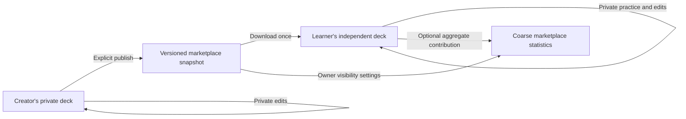

# Deck marketplace: first pass

Work is isolated on `feature/deck-marketplace`. This is a free, signed-in deck catalog inside Recollect. Publishing a deck is separate from sharing it privately with a friend. This branch is an evaluation pass, not a public marketplace deployment. Returning to `main` restores the existing product; this branch has not applied migrations to production.

## Ownership model

- The creator keeps their live deck. Only an explicit publication or update copies its current synced contents into the marketplace.
- A listing has a stable identifier, creator, publication status, metric visibility switches, and numbered snapshot versions. Published content does not follow private edits automatically.
- A download creates new recipient-owned deck/card identifiers and fresh review schedules through the normal server sync feed. It never imports the creator's review history or schedule.
- One technical receipt per learner/listing makes double taps, lost responses, and multiple devices return the same copy. A new published version does not overwrite an existing learner's edits. Restoring a removed copy or opting into an updated copy is separate future work.
- Unpublishing prevents subsequent discovery and new downloads. Existing independent copies remain usable. Account deletion removes the creator's listings and marketplace attribution, while retaining other learners' own libraries.

## Settings and permissions

| Setting                      | Controlled by | Default                   | Meaning                                                                      |
| ---------------------------- | ------------- | ------------------------- | ---------------------------------------------------------------------------- |
| Published                    | Creator       | Explicit Publish required | Listed, previewable and available to download                                |
| Show download count          | Creator       | Off                       | Return the number of retained successful download receipts                   |
| Show usage statistics        | Creator       | Off                       | Return coarse practice statistics only when the eligibility threshold is met |
| Contribute practice activity | Each learner  | Off                       | Allow eligible future practice on this downloaded copy to contribute         |

The first-pass interpretation of the creator's information switches is **public visibility**. The server enforces them for every viewer, including the creator: hidden fields are `null`, not hidden only by the UI. Changes apply to subsequent reads. Information already seen or captured cannot be recalled.

Download receipts remain necessary for duplicate prevention even when counts are hidden. Practice still belongs to the learner's ordinary private history. This implementation derives permitted aggregates on demand; it does not introduce a second analytics event stream or let a creator override a learner's permission.

Turning contribution off removes that learner from subsequent aggregate reads. Enabling it again starts a new consent period; earlier activity is not backfilled. Permission remains manageable from a downloaded deck even after its listing is unpublished or the creator is blocked. Detailed named progress stays in the separate, explicitly consented friend-sharing system.

## Usage information

Use a fixed rolling 30-day window across downloaded versions of the listing, with no person, card, date-range, or device drill-down. At least five active, consenting learners must have eligible reviews before any usage result is shown. The published result contains broad learner/review bands and a broad remembered/mixed/not-sure label, never exact learner identities, ratings, timestamps, card identifiers, or raw totals.

Both the review's occurrence and server receipt must fall after the current consent boundary. Only mapped cards from the downloaded snapshot qualify. Private new cards, moved cards, and cards edited since download are excluded, including edits later reverted. `good`/`easy` mean remembered; `again`/historical `hard` mean not sure. These are self-reported ratings, not objectively graded answers.

Broad bands and a threshold reduce exposure but do not guarantee anonymity. Small-group observation and prior outside knowledge remain possible; the consent explanation must describe aggregate contribution without promising anonymous data. Statistics can decrease when permissions change, accounts are deleted, or cards become ineligible. Download counts are not a claim of cumulative lifetime installs or active learners.

## API and persistence

- Catalog/search: `GET /v1/marketplace?query=…&cursor=…&limit=20`.
- Creator listings: `GET /v1/marketplace/mine`.
- Download receipts: `GET /v1/marketplace/downloads`.
- Listing preview: `GET /v1/marketplace/listings/:id` (at most five preview cards).
- Publish/update snapshot: `POST /v1/marketplace/listings` with an operation UUID, owned source deck, visibility settings, and explicit confirmation of sharing rights.
- Publication/settings: `PATCH /v1/marketplace/listings/:id`.
- Independent copy: `POST /v1/marketplace/listings/:id/download`.
- Learner contribution: `PATCH /v1/marketplace/listings/:id/usage`.
- Concerns and blocking: `POST /v1/marketplace/listings/:id/reports` and `POST /v1/marketplace/listings/:id/block-publisher`.

Migration `0006_marketplace.sql` adds listings, immutable versions, publication operation receipts, download receipts, card mappings, and private report records. Existing deck/card/review sync contracts stay unchanged. No native dependency or separate hosting service is needed.

Writes use account, listing and recipient sync locks in a consistent order. Publication operation IDs reject reuse with a different payload. Downloads are atomic with their normal sync changes and receipt. Current publication status, active accounts, blocking and owner permissions are checked on the server. Permission-sensitive responses must not be cached publicly.

The mobile client fetches on focus or explicit refresh rather than polling. Publication freezes the locally reviewed content, then requires successful synchronization with no pending changes or conflicts. A shared canonical content fingerprint binds that confirmation to the source deck and cards. The server compares it under its source locks and rejects a changed source before publishing; a successful pull cannot silently authorize unseen content from another device. An already accepted publication operation remains safely recoverable after a lost response. Download completion distinguishes a confirmed server receipt from a copy not yet present locally; interrupted synchronization offers a retry rather than claiming a completed import.

Bounds are 100 listings per creator and 1,000 cards / 2 MiB of encoded content per snapshot, with publication and read/action rate limits. Version storage and list query cost still need measured production retention/quotas before broad rollout.

## Public content and moderation

Only publish decks you have permission to distribute. Publishing requires an explicit confirmation. The existing limited text filter applies to creator names and published content; it is not comprehensive moderation. Public creator profiles contain a display name and identifier, without automatically exposing private profile photos or email.

Any viewer can report a visible listing and block its creator without first becoming friends. Reports preserve the reported version's snapshot in a private operator queue. Blocking prevents further marketplace access between the accounts and also revokes existing friend shares. Independent downloaded copies are not remotely erased.

Before a public launch, extend the support/privacy/community policy pages and operator moderation runbook to describe the actual marketplace. Verify the report review and content restriction workflow, creator/storage limits, snapshot retention, real-device flows, and account-deletion integration. No automatic moderator response or approval is implied by a successful publication.

## Deliberately deferred

Paid decks, ratings/reviews, rankings, recommendations, external deck file formats, automatic updates/merging of downloaded copies, public named progress, push notifications, and a moderator dashboard. PostgreSQL search and keyset pagination are sufficient for this evaluation pass; dedicated search/caching can follow measured load.
